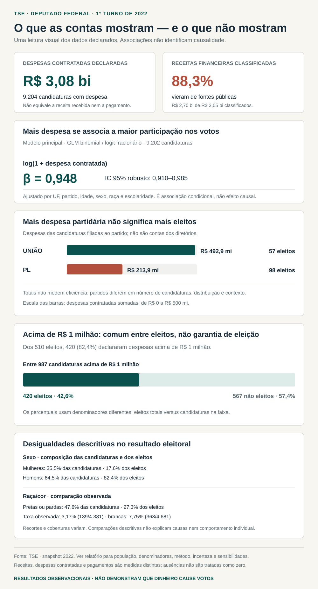

# Dinheiro Compra Votos?

Uma investigação reproduzível sobre despesas declaradas e resultados eleitorais. O título é uma pergunta; os dados observacionais não demonstram que dinheiro cause votos.

## O estudo em uma imagem



Para ver os resultados em oito lâminas: [carrossel completo (PDF)](reports/linkedin-carousel-2022/v4/carrossel-final.pdf).

## Escopo e interpretação

- Recorte: candidaturas a deputado federal no primeiro turno de 2022, nas 27 UFs. A população principal usa a situação `APTO` no snapshot congelado; isso não reconstrói a situação jurídica na data da eleição.
- As **9.476 candidaturas APTO** formam a população principal; a distribuição usa **9.204** com despesa contratada `Final` observada; o modelo principal usa **9.202** com despesas, votos e controles completos.
- Receita financeira, despesa contratada e pagamento declarado são medidas diferentes. A despesa não é necessariamente dinheiro público nem valor pago.
- As estimativas são descritivas ou associativas. Não demonstram causalidade, eficiência, desperdício ou decisões de eleitores individuais.
- Ausência de registro não é zero observado. Recortes, coberturas e denominadores variam; consulte o relatório antes de comparar números.

## Relatórios e dados

- [Relatório principal: análise financeira, resultados e limitações](reports/tse-2022-financial-analysis.md)
- [Índice dos relatórios e tabelas versionadas](reports/README.md)
- [Coeficientes dos modelos](reports/tse-2022-financial-model-estimates.csv) · [cenários de despesa previstos pelo modelo](reports/tse-2022-predicted-expense-scenarios.csv)
- [Distribuição de receitas, despesas e pagamentos](reports/tse-2022-financial-distribution-totals.csv) · [comparação descritiva de despesa e eleição](reports/tse-2022-election-expense-comparison.csv)
- [Protocolo de reprodução e fontes](docs/pilot-2022-reproduction.md) · [decisões metodológicas](docs/dinheiro-compra-votos-investigacao-design.md) · [guia do repositório](docs/repository-guide.md)

## Reproduzir

Requer Python 3.11.x e UV 0.9.15 ou superior. Os dados brutos não estão versionados; siga o [protocolo de reprodução](docs/pilot-2022-reproduction.md) para obtê-los e executar o snapshot congelado.

```sh
uv sync --locked
uv run --locked python -m unittest discover -s tests -v
uv run --locked python -m tse_pilot run --manifest data/manifests/manifest-20261008T154908Z.json --output data/derived/2022
uv run --locked python -m tse_pilot analyze --database data/derived/2022/pilot.sqlite --validation data/derived/2022/validation.json --output reports
```

Para a execução completa, análises complementares ou Docker, use os comandos e pré-requisitos do protocolo. Os resultados e tabelas publicados podem ser consultados sem executar o pipeline.

## Status

Concluído: análise reproduzível do recorte TSE 2022, validações, relatório principal e análises complementares. Extensão a 2026, métricas de redes sociais e *backtests* históricos ainda não foram concluídos.
